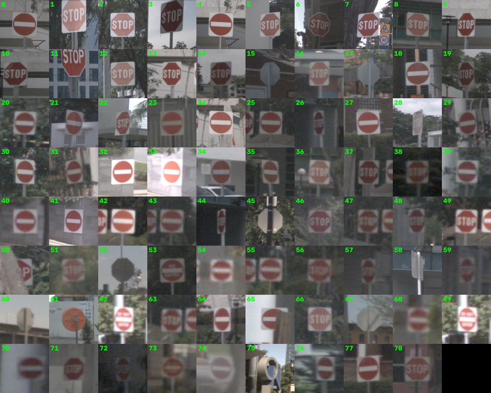
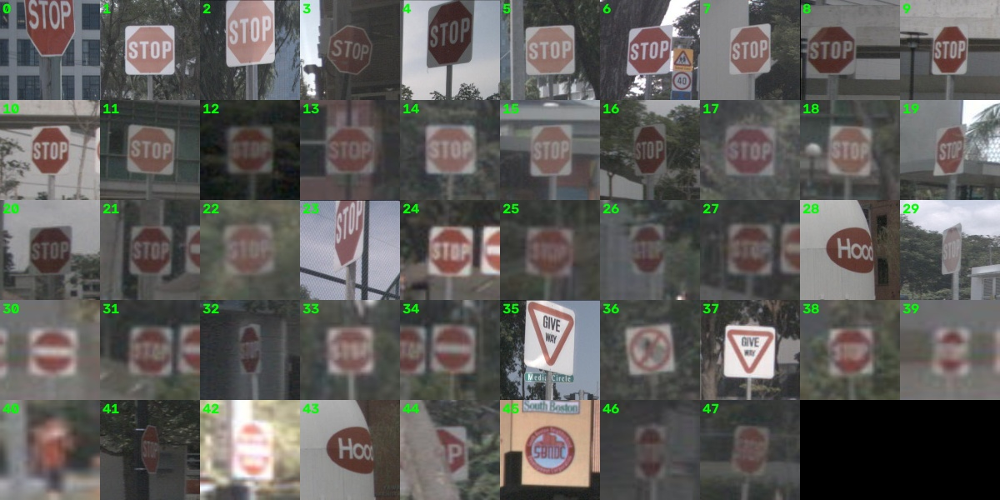
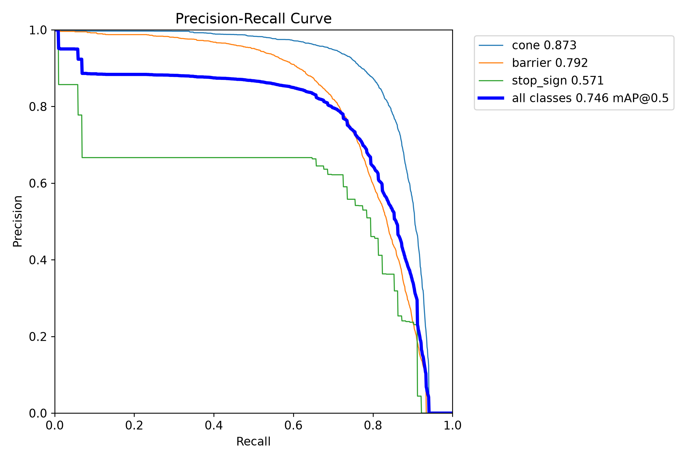
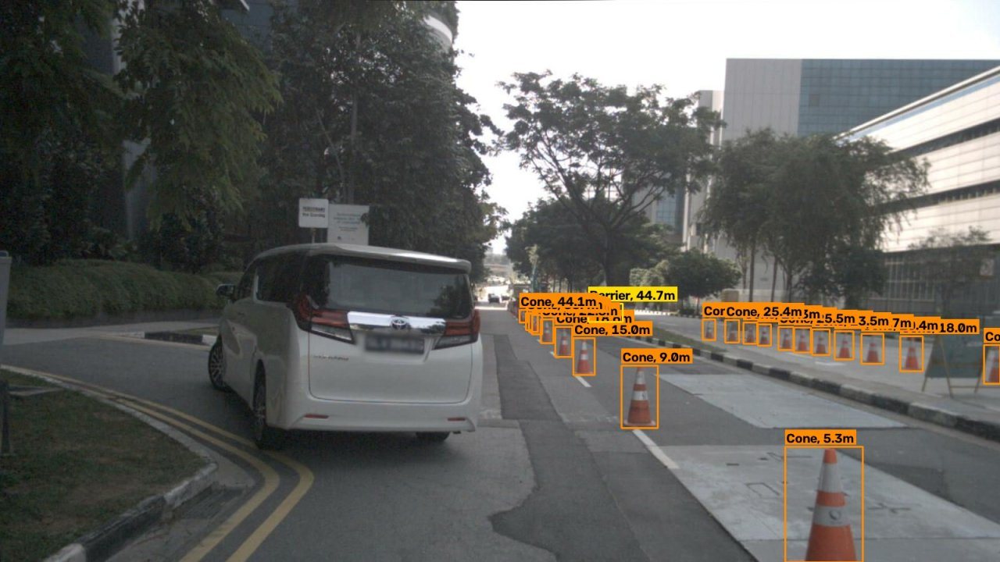
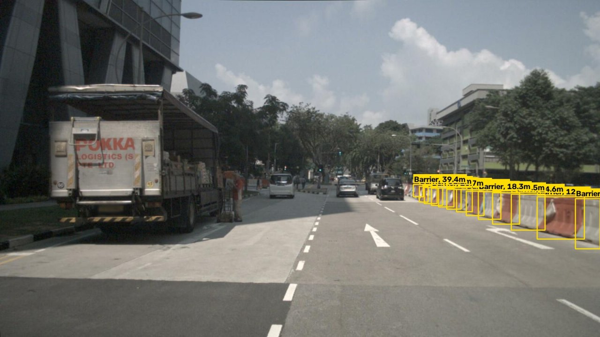
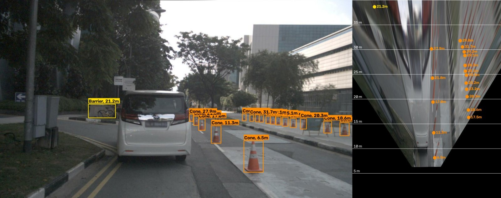
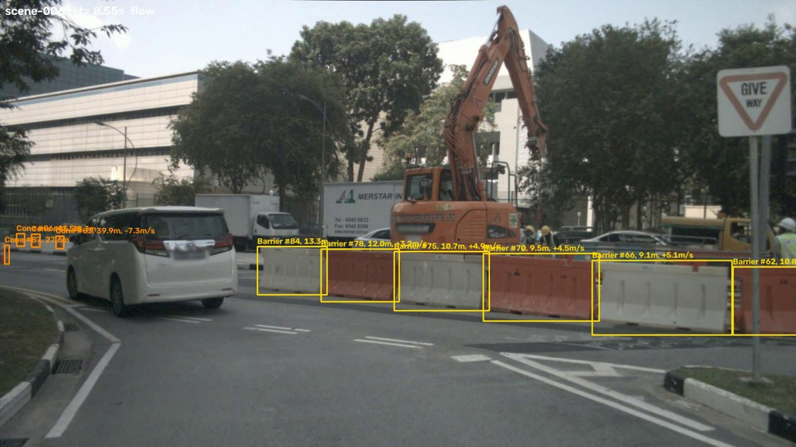

# ERIC Robotics ML Assignment | Arya Maddel

## Contact Information

- **Name:** Arya Maddel
- **Phone:** 8806642286
- **Email:** aryamaddel@gmail.com

Detects **cones, barriers and stop signs**, labels each with its **distance from the camera** (`Cone, 6.4m`), and runs fast on limited hardware.

_Final model on a held-out nuImages frame: the stop sign is detected with its distance, and the **No Entry** sign next to it is correctly ignored. An earlier model version confused the two (2)._

| Requirement                          | What was built                                                                                                                             | Key result                                                                                                                              |
| ------------------------------------ | ------------------------------------------------------------------------------------------------------------------------------------------ | --------------------------------------------------------------------------------------------------------------------------------------- |
| **1. Detection** (transfer learning) | COCO-pretrained **YOLO26n** fine-tuned on cones + barriers (nuImages) and stop signs (Mapillary)                                           | test **mAP50: cone 0.863, barrier 0.769, stop sign 0.817**                                                                              |
| **2. Distance** (geometry)           | pinhole model $Z = f_y H / h$ with class height priors + ground-plane fallback; labels like `Cone, 6.4m`                                   | validated against **nuScenes 3D ground truth**: median error **cone 6.5%**, **barrier 9.6%** (end-to-end, detector boxes)               |
| **3. Edge optimization**             | OpenVINO **INT8 quantization**, TensorRT, **structured pruning**, input resolution; desktop **and** emulated small-device CPUs             | **CPU 960 px: 18 → 41 FPS** (INT8, −0.010 mAP50); **GPU (L4) 960 px: 61 → 178 FPS** (TensorRT FP16); 4 slow cores at 512 px: **34 FPS** |
| Extra                                | bird's-eye view (homography), optical-flow tracking with closing speed, stereo disparity → depth derivation; hand-crafted feature baseline | BEV distance agrees with the pinhole estimate within ~5% to 30 m; tracker runs the detector on 1 of 3 frames                            |

One finding worth highlighting: the first model's stop-sign precision looked fine on its own test set (0.89), but on Singapore street scenes **more than half** of its stop-sign detections were _No Entry_ signs. The cause was noisy automatic labels. Reviewing those labels fixed it (47% → 94% correct) and also gave the best scores on every class (§2).

Also: **INT8 costs only ~0.01 mAP50** for a 2–3× CPU speed-up, lowering the input size beats pruning for this nano model (§5.3), and hand-crafted colour/shape detectors were tested and fell far short (AP50 0.16 vs 0.81, §5.5).

## 2. Data

### Why not (only) BDD100K

BDD100K's detection labels have a single generic `traffic sign` class and no cones or barriers. Its panoptic labels do contain `traffic cone`, but as a _stuff_ class, without instance IDs ([format docs](https://doc.bdd100k.com/format.html)), so there are no per-cone boxes, and there is no stop-sign class at all. Relabelling every BDD `traffic sign` as a stop sign would be wrong, so I used datasets that label exactly these objects (the brief allows other relevant datasets):

| Purpose               | Dataset                                                                                                          | Classes used                                                                                                                     |
| --------------------- | ---------------------------------------------------------------------------------------------------------------- | -------------------------------------------------------------------------------------------------------------------------------- |
| Cones, barriers       | [nuImages](https://www.nuscenes.org/nuimages) (Boston / Singapore, 6 cameras)                                    | `movable_object.trafficcone` → **cone**, `movable_object.barrier` → **barrier** ("temporary barrier placed to redirect traffic") |
| Stop signs            | [Mapillary Traffic Sign Dataset v2](https://www.mapillary.com/dataset/trafficsign) (global street-level imagery) | `regulatory--stop--*` → **stop_sign**                                                                                            |
| Distance ground truth | [nuScenes v1.0-mini](https://www.nuscenes.org/nuscenes)                                                          | 3D boxes of cones / barriers + calibrated cameras                                                                                |

### Subsets and splits

| Split | nuImages images | MTSD images | Stop signs (human-labelled) |
| ----- | --------------- | ----------- | --------------------------- |
| train | 8,800           | 1,609       | 1,268                       |
| val   | 1,650           | 128         | 102                         |
| test  | 1,650           | 103         | 81                          |

- **nuImages:** 8,000 / 1,500 / 1,500 frames containing cones or barriers, plus 10% background frames. Val and test are split **by driving log**, so near-identical frames from one drive never end up on both sides.
- **MTSD:** every fully-annotated image with a stop sign (1,287), plus 600 _hard negatives_: images with look-alike red signs (no-stopping, stop-ahead) but no stop sign. 47 panoramas were dropped (pinhole geometry doesn't apply). MTSD's own test split has no public labels, so its val split is divided deterministically into val and test.
- **Bandwidth:** MTSD ships as ~45 GB of zips. `scripts/fetch_remote_zip_members.py` reads each zip's central directory over HTTP range requests and downloads only the 1,887 needed images (1.7 GB, CRC-checked). The 16 GB nuImages archive was streamed through `tar` inside Modal, keeping only the 12,100 selected frames, so it never touched the local machine.

### Partial labels: three attempts, and what went wrong with the first

Merging datasets with different label sets creates _false negatives_: nuImages frames contain stop signs that nobody labelled, so training would teach the model to suppress real stop signs. A COCO-pretrained **YOLO26x** teacher (COCO class 11 = "stop sign") was used to find them in the nuImages **train** frames. Val/test labels were never modified.

| Version        | Handling of teacher detections in nuImages train                                                                                                | Outcome                                                                                                                                                |
| -------------- | ----------------------------------------------------------------------------------------------------------------------------------------------- | ------------------------------------------------------------------------------------------------------------------------------------------------------ |
| v1             | conf ≥ 0.5 detections **added as stop-sign labels**                                                                                             | MTSD test looked fine (stop precision 0.89), but on Singapore street scenes **53% of stop-sign detections were wrong**: 33 of 79 were _No Entry_ signs |
| v2             | all candidates (conf ≥ 0.25) **greyed out** (ignore regions)                                                                                    | confusion gone (12 / 13 correct), but **recall collapsed** (12 real stop signs found vs 37)                                                            |
| **v3 (final)** | all 668 candidates **reviewed visually**: 146 stop signs → labels; 364 look-alikes kept visible as **hard negatives**; 158 unclear → greyed out | **32 / 34 correct** while recovering nearly all of v1's recall; best test mAP on all three classes                                                     |

Root cause: of the teacher's confident (≥ 0.5) detections, only **126 / 372 (34%) were actually stop signs**. The rest were No Entry / Do Not Enter signs, the backs of octagonal signs, mirrors and logos, so v1 had _learned_ the confusion. The MTSD test split could not reveal it because it contains few No Entry signs; it surfaced only by inspecting predictions on a different domain. The review file is [`results/stop_sign_audit/teacher_candidates_review.json`](results/stop_sign_audit/teacher_candidates_review.json), and the before/after crop grids are in the same folder.

_v1: every "stop sign" detection on nuImages test, ranked by confidence. Many are No Entry signs._

_v3 (conf ≥ 0.2): almost all are real stop signs; the remaining errors are Give Way signs, logos and a few No Entry signs at low confidence._

### Evaluation protocol

Since each source only has human labels for some classes, metrics are computed **per source**: cones and barriers on the nuImages test split, stop signs on the MTSD test split. This way no class is penalised for objects that simply weren't labelled.

### Licences

nuScenes/nuImages (CC BY-NC-SA 4.0 under the Motional Terms of Use) and MTSD (CC BY-NC-SA, research use with a confidentiality clause) are non-commercial. **No data is committed to this repo**; `data/` is git-ignored and all subsets are rebuilt by the scripts.

---

## 3. Detection: transfer learning

- **Model:** Ultralytics **YOLO26n** (2.5 M params), pretrained on COCO, fine-tuned for 3 classes. It has an NMS-free head, which keeps post-processing cheap on CPU and is a good fit for edge deployment.
- **Input size 960 px:** the objects are small (median heights at full resolution: cones 42 px, barriers 45 px of 900; stop signs 56 px of ~3000). At 640 px many would shrink below ~15 px. Section 5 measures the 640-vs-960 trade-off.
- **Training:** 60 epochs, batch 64, AdamW (lr 0.001429, chosen by Ultralytics' `optimizer=auto`), cosine LR, mosaic off for the last 10 epochs, early-stopping patience 15, AMP, on one H100 (Modal); ~23 s/epoch, ~25 min per run.
- **CPU-only sanity run:** before using the GPU, a 15-epoch run on the stop-sign subset on a desktop i5-13400F reached **stop-sign val mAP50 = 0.71** at 640 px. This confirmed the pipeline learns without any cloud compute.

### Test results (final model v3, YOLO26n @ 960, per-source test splits)

| Class     | Test set                       | Precision | Recall | mAP50     | mAP50-95 |
| --------- | ------------------------------ | --------- | ------ | --------- | -------- |
| Cone      | nuImages test: 1,650 imgs      | 0.842     | 0.812  | **0.863** | 0.521    |
| Barrier   | nuImages test: 1,650 imgs      | 0.823     | 0.677  | **0.769** | 0.501    |
| Stop sign | MTSD test: 103 imgs / 81 signs | 0.952     | 0.679  | **0.817** | 0.620    |

Ablation over the three label-handling variants (same data otherwise, same training recipe; [`results/training/ablation_test_metrics.json`](results/training/ablation_test_metrics.json)):

|                       | Cone mAP50 | Barrier mAP50 | Stop mAP50 | Stop precision (MTSD) | Stop detections correct on nuImages test (conf ≥ 0.4) |
| --------------------- | ---------- | ------------- | ---------- | --------------------- | ----------------------------------------------------- |
| v1 auto pseudo-labels | 0.861      | 0.762         | 0.808      | 0.887                 | 37 / 79 (47%)                                         |
| v2 mask candidates    | 0.859      | 0.766         | 0.813      | 0.933                 | 12 / 13 (92%)                                         |
| **v3 reviewed**       | **0.863**  | **0.769**     | **0.817**  | **0.952**             | **32 / 34 (94%)**                                     |

Training budget: a 5-epoch run on 25% of the data reached mAP50 0.67 / 0.57 / 0.74 (cone / barrier / stop). In the full runs, 95% of the final mAP50-95 was reached by epoch 22–27 and 98% by epoch 32–38, so ~35 epochs would give nearly the same model at ~60% of the cost. Training curves, PR curves and the confusion matrix are in [`results/training/`](results/training/).

Notes:

- Barrier recall is the weakest. The class covers concrete, metal and water-filled barriers of any length, and long runs are annotated as several adjacent boxes. Splitting a continuous barrier into the same segments as the annotator is inherently ambiguous, which likely costs recall.
- The stop-sign test split is small (81 signs), so its metrics are noisier than the cone/barrier ones.

---

## 4. Distance estimation (geometry)

**Pinhole model.** An object of real height _H_ at depth _Z_ along the optical axis appears with image height

$$h = \frac{f_y\,H}{Z} \quad\Rightarrow\quad Z = \frac{f_y\,H}{h}, \qquad f_y = \frac{f\,[\text{mm}]}{\text{pixel pitch}\,[\text{mm}]} = K_{11}.$$

The _range_ reported on each box is the Euclidean distance from the camera, using the ray through the box centre: $\lVert Z\,K^{-1}[u\;v\;1]^\top\rVert$.

- Box **height**, not width, is used: cones and signs look the same height from any angle, while a barrier's visible width depends on its length and orientation.
- **Class height priors** (configurable in `distance.py`): cone 0.70 m (28″ road cone), barrier 1.00 m (jersey / water-filled), stop sign 0.75 m (30″ octagon face only, not the post).
- **Truncation fallback:** if a box's top edge is cut off by the image border, its pixel height is too small. If the bottom (ground contact) is still visible, the estimator switches to the **ground-plane** relation $Z = f_y\,h_{cam}/(v_{bottom}-c_y)$, which needs the camera height.
- **Intrinsics:** read from a camera YAML (`configs/`). Either a full _K_, rescaled automatically for other resolutions, or a horizontal FOV for uncalibrated cameras ($f = \tfrac{W/2}{\tan(\text{HFOV}/2)}$).

### Quantitative evaluation against nuScenes 3D ground truth

`eval_distance.py` transforms every cone/barrier 3D box (visibility ≥ 40%) from global → ego → camera coordinates to get the true distance, for all 6 cameras of the 404 key frames in nuScenes v1.0-mini. Each object is then matched to the **final detector's** box (same class, IoU ≥ 0.3 against the projected 3D box), and the distance is estimated from that box with the **default** height priors. **79% of the 3,156 ground-truth objects were matched.**

| Class       | True range | n    | Median rel. error | Median abs. error | Within ±10% | Within ±20% |
| ----------- | ---------- | ---- | ----------------- | ----------------- | ----------- | ----------- |
| **cone**    | **all**    | 1092 | **6.5%**          | 1.07 m            | 74%         | 86%         |
| cone        | 0–10 m     | 213  | 7.9%              | 0.59 m            | 62%         | 68%         |
| cone        | 10–20 m    | 411  | 6.3%              | 0.92 m            | 82%         | 87%         |
| cone        | 20–40 m    | 403  | 5.8%              | 1.55 m            | 78%         | 94%         |
| cone        | 40+ m      | 65   | 10.2%             | 4.64 m            | 49%         | 89%         |
| **barrier** | **all**    | 1393 | **9.6%**          | 1.86 m            | 53%         | 94%         |
| barrier     | 0–10 m     | 127  | 15.6%             | 1.22 m            | 17%         | 78%         |
| barrier     | 10–20 m    | 588  | 11.0%             | 1.69 m            | 44%         | 95%         |
| barrier     | 20–40 m    | 407  | 7.0%              | 2.12 m            | 70%         | 98%         |
| barrier     | 40+ m      | 271  | 8.2%              | 3.79 m            | 62%         | 90%         |

How to read this:

- **Relative error is roughly constant (6–10%)**, so absolute error grows with distance. That's the behaviour you'd expect from $Z = f_yH/h$: a fixed pixel error on _h_ matters more when _h_ is small.
- **Close range is worst for barriers (15.6% at 0–10 m).** This is most likely because near barriers are often cut off by the image edge, or seen from above at a steep angle, so the box height no longer equals the barrier's face height.
- **Height priors: fitting from data helps cones but hurts barriers.** Fitting each class's height from the nuScenes 3D boxes (leave-one-scene-out, so no scene is used to fit its own prior) brings cone error down to **3.8%**. Barriers get _worse_ (14.0%), because the 3D boxes are 1.07 m tall while the visible face the detector boxes is shorter. The deployed estimator therefore keeps the default priors; both variants are in [`results/distance_eval/distance_eval.json`](results/distance_eval/distance_eval.json).
- With _perfect_ boxes (projected 3D GT), the error is _higher_ (cone 11.9%), because a projected 3D box includes the object's depth extent and is looser than a tight detector box. So the evaluation above is not flattered by using GT geometry.

---

## 5. Edge optimization

All variants are exported from the same trained weights and **re-scored on the same test sets**, so every speed-up is shown with its accuracy cost. Two latencies are reported per frame (batch 1, after warm-up, 100 test images × 3 rounds, median):

- **end-to-end**: what a robot experiences (letterbox resize + inference + post-processing);
- **inference only**: the network forward pass.

**Measurement hygiene.** The i5-13400F mixes 6 performance cores (P) with 4 efficiency cores (E). Unpinned, Windows moved inference threads between core types and OpenVINO latency varied by ±25% between runs. Each configuration therefore runs **pinned to a fixed core set**, with every thread pool (PyTorch, OpenCV, OpenVINO) sized to it and busy-wait spinning disabled (`benchmark.py --cores`). Round-to-round spread is now < 5%. The same mechanism emulates a **smaller edge CPU** (4 E-cores).

### 5.1 Accuracy of each export (test mAP50)

| Input | Format                  | Size (MB) | Cone  | Barrier | Stop sign | Mean      |
| ----- | ----------------------- | --------- | ----- | ------- | --------- | --------- |
| 960   | PyTorch FP32 (baseline) | 5.5       | 0.863 | 0.769   | 0.818     | **0.817** |
| 960   | OpenVINO FP32           | 10.1      | 0.865 | 0.770   | 0.805     | 0.814     |
| 960   | **OpenVINO INT8**       | **3.5**   | 0.862 | 0.765   | 0.795     | **0.807** |
| 640   | PyTorch FP32            | 5.5       | 0.773 | 0.684   | 0.721     | 0.726     |
| 640   | **OpenVINO INT8**       | 3.3       | 0.768 | 0.675   | 0.708     | 0.717     |
| 512   | PyTorch FP32            | 5.5       | 0.689 | 0.621   | 0.630     | 0.647     |
| 512   | **OpenVINO INT8**       | 3.3       | 0.683 | 0.612   | 0.617     | 0.637     |

**INT8 post-training quantization** (OpenVINO + NNCF, calibrated on 30% of the val split) costs only **~0.01 mAP50** at every resolution and makes the model 3× smaller than the FP32 IR. The PyTorch `.pt` file is FP16 storage, hence 5.5 MB. **Input resolution matters far more**: 960 → 640 costs 0.09 mAP50, 640 → 512 another 0.08, because the objects are small.

### 5.2 CPU speed

OpenVINO is the CPU runtime because the target is an Intel CPU; ONNX Runtime gave similar FP32 speed (within ~12%).

| Input | Format            | Desktop, 6 P-cores: e2e / inference (ms) | FPS     | Speed-up  | Small device, 4 E-cores: e2e / inference (ms) | FPS    | Speed-up  |
| ----- | ----------------- | ---------------------------------------- | ------- | --------- | --------------------------------------------- | ------ | --------- |
| 960   | PyTorch FP32      | 54.2 / 49.7                              | 18      | 1.00×     | —                                             |        |           |
| 960   | OpenVINO FP32     | 43.5 / 37.2                              | 23      | 1.24×     | —                                             |        |           |
| 960   | **OpenVINO INT8** | **24.2 / 17.6**                          | **41**  | **2.24×** | —                                             |        |           |
| 640   | PyTorch FP32      | 35.9 / 33.3                              | 28      | 1.00×     | 70.1 / 66.2                                   | 14     | 1.00×     |
| 640   | OpenVINO FP32     | 18.5 / 15.0                              | 54      | 1.94×     | 65.1 / 60.0                                   | 15     | 1.08×     |
| 640   | **OpenVINO INT8** | **12.3 / 8.9**                           | **81**  | **2.92×** | **43.5 / 38.5**                               | **23** | **1.61×** |
| 512   | PyTorch FP32      | 27.8 / 25.7                              | 36      | 1.00×     | 52.4 / 49.4                                   | 19     | 1.00×     |
| 512   | **OpenVINO INT8** | **8.3 / 5.9**                            | **120** | **3.34×** | **29.1 / 25.5**                               | **34** | **1.80×** |

### 5.3 Structured pruning

| Model              | Compute (GMACs @640) | Params   | Mean mAP50 (INT8)  | INT8 latency, 6 P-cores | INT8 latency, 4 E-cores |
| ------------------ | -------------------- | -------- | ------------------ | ----------------------- | ----------------------- |
| Base, 640 px       | 2.92                 | 2.54 M   | 0.717              | 12.3 ms                 | 43.5 ms                 |
| Pruned 30%, 640 px | **1.59 (−46%)**      | 1.54 M   | 0.612 (**−0.105**) | 10.4 ms                 | 29.9 ms                 |
| _Base, 512 px_     | _≈1.87 (scaled)_     | _2.54 M_ | _**0.637**_        | _**8.3 ms**_            | _**29.1 ms**_           |

### 5.4 GPU (NVIDIA L4, Modal)

| Input | Format            | End-to-end (ms) | Inference (ms) | FPS     | Speed-up  | Mean mAP50 |
| ----- | ----------------- | --------------- | -------------- | ------- | --------- | ---------- |
| 960   | PyTorch FP32      | 16.3            | 11.74          | 61      | 1.00×     | 0.817      |
| 960   | PyTorch FP16      | 16.8            | 12.17          | 60      | 0.97×     | 0.816      |
| 960   | **TensorRT FP16** | **5.6**         | **1.09**       | **178** | **2.90×** | **0.811**  |
| 960   | TensorRT INT8     | 5.6             | 1.04           | 178     | 2.90×     | 0.800      |
| 640   | PyTorch FP32      | 14.3            | 11.19          | 70      | 1.00×     | 0.726      |
| 640   | **TensorRT FP16** | **4.0**         | **0.74**       | **250** | **3.59×** | 0.723      |
| 640   | TensorRT INT8     | 4.1             | 0.73           | 244     | 3.51×     | 0.705      |

### 5.5 Hand-crafted features: tested, not adopted

Since the target classes have distinctive colours and shapes, classical detectors were implemented and evaluated with the same AP50 protocol (`handcrafted.py`, `scripts/eval_handcrafted.py`):

- **stop sign**: red mask (two hue bands, adaptive white via Otsu) + convex near-square polygon + "white letters, not a solid white bar" (the No Entry signature);
- **cone**: orange mask, closed vertically across the white reflective bands, then elongated shape;
- **barrier**: none. Concrete / metal / water-filled barriers in many colours have no reliable colour or shape signature.

| Method                                | Test set      | AP50      | Max recall | Speed     |
| ------------------------------------- | ------------- | --------- | ---------- | --------- |
| Hand-crafted stop-sign detector       | MTSD test     | 0.160     | 35%        | 13 ms/img |
| Hand-crafted cone detector            | nuImages test | 0.007     | 7%         | 8 ms/img  |
| CNN stop signs (YOLO26n v3)           | MTSD test     | **0.812** | 89%        | —         |
| CNN + hand-crafted stop-sign verifier | MTSD test     | 0.687     | 74%        | —         |

- **Standalone, hand-crafted detectors are far behind.** nuImages "traffic cones" are mostly straight-sided orange/white channeliser posts with washed-out colours. Colour blobs merge neighbouring posts or break at the white stripes, so their boxes rarely reach IoU 0.5.
- **As a verifier, the white-bar test separated the classes perfectly on v1's errors**: it rejected all 33 No Entry signs and all 6 sign backs, tuned on the v1 audit set. It would have been a good fix for v1. But the final model already learned that distinction from the reviewed labels. On held-out data the verifier now mostly removes _real_ small or blurry stop signs, whose letters blur into a bar, and lowers AP50 from 0.81 to 0.69. So it is not used.

---

## 6. Extra credit

### 6.1 Bird's-eye view (homography / inverse perspective mapping)

For a calibrated camera with rotation _R_ and position _t_ (camera → ego frame), a ground point $(x, y, 0)$ projects as

$$s\,[u\;v\;1]^\top = K\,[\,R^\top e_1 \;\; R^\top e_2 \;\; -R^\top t\,]\,[x\;y\;1]^\top = H\,[x\;y\;1]^\top .$$

_H_ is the ground-plane homography. Warping the image with $H^{-1}$ gives a metric top-down view. Mapping each box's bottom-centre through $H^{-1}$ gives a **second, size-independent distance estimate**, which agrees with the pinhole estimate to within about 5% out to ~30 m (`bev.py`).

_Left: camera view with pinhole distances. Right: the same frame warped to a metric top-down view (5 m grid); dots are each detection's ground-contact point. The cones line up along the lane edge._

### 6.2 Optical-flow tracking

`track.py` runs the detector only every _N_ frames (default 3). In between, boxes are propagated with pyramidal **Lucas–Kanade** flow: the median motion of corner features inside each box shifts it, and the change in their spread rescales it. Detections are associated with propagated tracks by IoU. This cuts detector calls ~3× and gives each object a distance history, so each label also shows the **closing speed** (linear fit over the last second), e.g. `Barrier #61, 9.8m, +4.4m/s`.

On nuScenes scene-0061 (224 front-camera frames at 11.6 Hz, including the 12 Hz _sweeps_ between key frames) the detector ran on **75 of 224 frames**. Clip: [`results/demo/tracking_scene-0061.mp4`](results/demo/tracking_scene-0061.mp4).

### 6.3 Epipolar geometry: disparity → depth

In a rectified stereo pair (focal length $f$, baseline $B$), a point at depth $Z$ projects to $u_L = f\frac{X}{Z} + c_x$ and $u_R = f\frac{X - B}{Z} + c_x$, so

$$d = u_L - u_R = \frac{f\,B}{Z} \quad\Rightarrow\quad Z = \frac{f\,B}{d}, \qquad \left|\frac{\partial Z}{\partial d}\right| = \frac{Z^2}{f\,B}.$$

A 1 px disparity error therefore grows quadratically with distance, the same reason the monocular errors in §4 grow with range. Stereo removes the need for the class-height prior.
