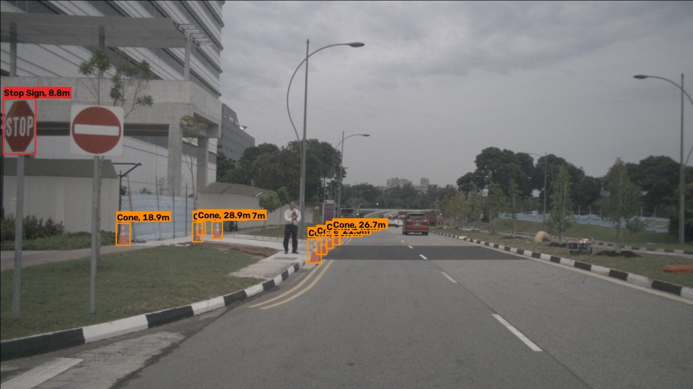

# ERIC Robotics ML Assignment

**Name**: Arya Mandar Maddel

**email**: aryamaddel@gmail.com

**phone number**: 8806642286

Detect **cones, barriers and stop signs**, estimate their distance from the camera, and compare CPU/GPU deployment optimizations. Includes bird’s-eye projection, optical-flow tracking and the stereo disparity–depth derivation.



## Steps taken for the assignment

1. **Choose datasets for the required classes.** BDD100K does not provide the cone, barrier and stop-sign detection labels needed here. We chose **nuImages** for cones/barriers and **Mapillary Traffic Sign Dataset (MTSD)** for stop signs, as the assignment allows other relevant datasets.

2. **Prepare the data.** We selected relevant images and background/hard-negative examples, converted bounding boxes to YOLO format, and created training, validation and test splits. nuImages evaluation splits were separated by driving log to reduce leakage between similar frames; MTSD panoramas were excluded.

3. **Start with a pretrained model.** We chose the lightweight **YOLO26n**, pretrained on COCO, to keep CPU inference practical instead of training a detector from scratch.

4. **Handle incomplete labels across datasets.** Mapillary supplied human-labelled stop signs, but stop signs visible in nuImages still lacked labels. We used COCO-pretrained **YOLO26x** to propose those missing labels, then reviewed its mistakes before training YOLO26n. The explanation below covers why Mapillary alone did not solve this problem. Validation/test labels were left unchanged.

5. **Apply transfer learning by fine-tuning.** We adapted the pretrained YOLO26n to our three classes using the prepared data. The final training run used 960 px inputs, a 60-epoch budget and an H100 GPU on Modal because a suitable local GPU was unavailable. Fine-tuning is the transfer-learning method used here, rather than a separate training stage.

6. **Evaluate the detector.** We measured precision, recall, mAP50 and mAP50-95 on held-out data. Cones/barriers were evaluated on nuImages and stop signs on MTSD, so objects without source labels were not counted as detection errors for those classes. We also inspected stop-sign mistakes across domains and compared the label-handling variants.

7. **Estimate distance from camera geometry.** For each detected box, we used camera intrinsics, bounding-box height and a class-height prior in the pinhole relation **Z = fy * H / h**. We converted depth to camera range, added a ground-plane fallback for top-truncated objects and drew labels such as `Cone, 6.4m`.

8. **Validate distance estimates.** We matched detector boxes to nuScenes 3D ground truth for cones/barriers, measured absolute and relative errors by distance range, and compared default versus fitted height priors. Stop-sign distance remains an estimate without equivalent 3D-ground-truth validation in this project.

9. **Compare CPU optimizations.** We exported OpenVINO FP32 and INT8 models, calibrated INT8 using validation images, and compared accuracy, latency, FPS and model size against PyTorch. We also tested input resolution and structured channel pruning followed by fine-tuning. CPU/GPU comparisons record the hardware and runtime settings; current CPU scripts leave thread management at library defaults.

10. **Compare GPU inference.** On Modal's L4 GPU, we benchmarked PyTorch against TensorRT FP16 and INT8, reporting speed alongside accuracy. H100 training and L4 benchmarking serve different purposes; their results are reported separately.

11. **Implement bird's-eye projection and tracking.** We used a calibrated ground-plane homography for a metric bird's-eye view, and Lucas-Kanade optical flow to propagate boxes between detector frames. Track distance histories also provided closing-speed estimates.

12. **Explore stereo geometry and a classical baseline.** We derived **Z = fB/d** and its depth-error relation for rectified stereo. Separately, we evaluated handcrafted colour/shape detectors and a stop-sign verifier; they underperformed the final CNN and were not adopted. The stereo work is a derivation, not an implemented stereo depth pipeline.

13. **Save evidence and simplify reproduction.** We retained trained weights, metrics, training plots, label audits and annotated demos. The implementation is a set of direct scripts in `src/`, with local CPU inference and Modal GPU training, evaluation and inference commands documented below.

## Setup and data

This is a collection of assignment scripts in `src/`, not an installable application. `uv` manages dependencies only; run scripts directly with `uv run python src/<script>.py`.

```powershell
uv sync
```

The supplied final and 30% pruned weights are in `weights/`. Prediction needs no dataset download. Benchmarks require the prepared YOLO dataset in `data/yolo/`; data is not committed.

The detector is COCO-pretrained YOLO26n, fine-tuned on **nuImages** cones/barriers and **Mapillary Traffic Sign Dataset** stop signs. BDD100K lacks the required per-class detection labels; the brief allows other datasets. Evaluation is per source to avoid penalizing objects without labels. nuImages evaluation splits are separated by driving log; stop-sign pseudo-labels were visually reviewed before training.

Dataset preparation lives in `src/prepare_nuimages.py`, `src/prepare_mtsd.py`, `src/fetch_remote_zip_members.py` and `src/fetch_app.py`. nuImages/nuScenes and MTSD are for non-commercial/research use under their respective terms.

## Why two datasets and a teacher model were needed

**We used nuImages for cones/barriers and Mapillary (MTSD) for stop signs.** We did not choose nuImages because it labels stop signs. An image can contain an object even when the dataset does not annotate that object class.

| Dataset | Human labels used | What can still be visible without labels |
|---|---|---|
| nuImages | Cones and barriers | Stop signs |
| Mapillary / MTSD | Stop signs | Cones and barriers |

**Why missing labels matter.** Imagine a nuImages training image with a labelled cone and an unlabelled stop sign. Standard detector training treats unmatched predictions as background, so it can penalize a correct stop-sign prediction there. Meanwhile, a labelled Mapillary image teaches it to detect stop signs. Combining the images without addressing incomplete labels therefore creates conflicting training signals.

Ideally, every visible object belonging to our three target classes would be labelled. A few missed labels do not make training fail, but systematic omissions can hurt performance. Having labelled stop signs in Mapillary does not automatically fill missing labels in nuImages.

**Why fine-tune if pretrained YOLO already knows stop signs?** COCO-pretrained YOLO already recognizes stop signs, but COCO does not provide dedicated traffic-cone and navigation-barrier classes for this task. We fine-tuned one lightweight **YOLO26n** to produce our three classes. Training changes shared weights, and changing the detection head does not guarantee that its original stop-sign capability survives unchanged. Keeping stop-sign examples in training helps preserve and adapt that capability while learning cones and barriers. This is transfer learning; we did not learn stop signs from zero. We have not established that fine-tuning improves stop-sign accuracy over pretrained YOLO without a direct baseline comparison.

**Where the teacher came from.** Before training our own model, we used an already-trained **YOLO26x with COCO weights**. Its existing stop-sign class (COCO class ID 11) let it propose boxes in **nuImages training images**. It was not used to generate Mapillary's human labels. The teacher was larger because this was an offline label-proposal step where speed mattered less, and we hoped it would find difficult objects. A larger teacher was not required, and we did not compare teacher sizes to prove it was better.

**Why we reviewed the predictions.** The teacher confused No Entry signs and other look-alikes with stop signs. Accepting those predictions automatically introduced wrong training labels. We visually reviewed 668 candidates:

| Review decision | Candidates | Treatment in final training data |
|---|---|---|
| Real stop sign | 146 | Add a stop-sign bounding-box label |
| Look-alike / not a stop sign | 364 | Leave visible without a stop-sign label, as a hard negative |
| Uncertain | 158 | Grey out the region to avoid training on an ambiguous visible object |

These decisions are saved in [`teacher_candidates_review.json`](results/stop_sign_audit/teacher_candidates_review.json). `src/pseudo_label.py` applies them after removing stale stop-sign labels from nuImages training files. This reproduces final label preparation without running the teacher again; the old automatic-labeling experiments have been removed. Greying out a region changes its pixels; it is not a special loss-ignore mechanism.

**What this fixed, and what it did not.** Review reduced incorrect and missing stop-sign labels in nuImages; it did not guarantee that every stop sign was found. Cones/barriers visible in Mapillary may still be unlabelled, which remains a training limitation. We evaluate cones/barriers on nuImages and stop signs on Mapillary to avoid scoring detections against missing class annotations. That evaluation choice makes the reported metrics meaningful for each labelled source; it does not repair missing training labels. Validation and test labels were not changed by the teacher or review process.

## Run

Detect objects and annotate distances on an image, image folder or video:

```powershell
uv run python src/predict.py --camera nuscenes --source path/to/image.jpg
```

`--camera nuscenes` uses the built-in front-camera calibration; `--camera generic` assumes a 70° horizontal field of view and gives approximate distances. Defaults: `weights/best.pt`, 960 px, confidence 0.35, output `runs/predict/`. Existing `--weights`, `--out` and `--imgsz {640,960}` options support exported models and the tested resolutions.

Compare PyTorch FP32, OpenVINO FP32 and OpenVINO INT8 at 640 and 960 px:

```powershell
uv run python src/benchmark.py
uv run python src/benchmark.py --weights weights/best_pruned30.pt --out results/benchmark_cpu_pruned
uv run python src/report_tables.py
```

Only path overrides remain: `--weights`, `--data`, `--out`. CPU libraries use their defaults with **no custom thread limits or affinity**. Timing uses batch 1, 100 fixed test images, 10 warm-up frames and three rounds. It includes preprocessing, inference and postprocessing, excluding decoding, distance labels, drawing and output encoding. Accuracy uses the full per-source test splits; INT8 calibrates on 30% of validation data.

Train or evaluate on Modal (requires account setup, dataset volume and `uv sync --group dev`):

```powershell
uv run modal run --detach src/modal_app.py::train
uv run modal run src/modal_app.py::evaluate --name yolo26n_960_v3
uv run modal run src/modal_app.py::benchmark_gpu
```

Training fixes the final recipe: YOLO26n, 960 px, reviewed v3 data, cosine LR and mosaic disabled for the last 10 epochs. Only `--epochs`, `--batch` and `--name` remain. GPU types are set directly in the Modal decorators: H100 for training, evaluation, pruning and inference; L4 for the TensorRT benchmark. `NAVPERC_CPUS` selects the CPU allocation (default 8). Existing dataset archives and trained weights on `navperc-data` remain usable. Pruning uses `src/prune_app.py::prune_finetune` with the supplied 30% / 30-epoch defaults.

## GPU inference on Modal

Upload your image or video, then run annotated inference on the hardcoded H100:

```powershell
uv sync --group dev
uv run modal volume put navperc-data "D:\path\to\input.mp4" /inputs/input.mp4
uv run modal run src/modal_app.py::infer --source inputs/input.mp4 --camera generic
uv run modal volume get navperc-data /runs/yolo26n_960_v3/inference/input runs/modal_inference
```

`--source` is the uploaded path relative to the Modal volume root, not your local Windows path. It also accepts an uploaded image folder. `--camera generic` assumes a 70-degree horizontal field of view; use `nuscenes` for matching nuScenes front-camera images. Output video is `input_annotated.mp4`; image inference saves annotated images and `detections.json`.

The default weights are `/runs/yolo26n_960_v3/weights/best.pt` on `navperc-data`. Use `--name` for another trained run. To change GPUs, edit `gpu="H100"` on the relevant `@app.function(...)` in `src/modal_app.py` (or `src/prune_app.py` for pruning), for example to `gpu="L4"` or `gpu="T4"`. The TensorRT benchmark keeps its explicit `gpu="L4"`. Inference uses CUDA device 0 and retains the distance annotations. No GPU jobs were launched while adding this entry point.

## Results

Final detector at 960 px (per-source held-out test sets):

| Class     | mAP50 | mAP50–95 |
| --------- | ----- | -------- |
| Cone      | 0.863 | 0.521    |
| Barrier   | 0.769 | 0.501    |
| Stop sign | 0.818 | 0.621    |

Saved CPU run on the i5-13400F at 960 px:

| Runtime       | FPS  | Mean mAP50 |
| ------------- | ---- | ---------- |
| PyTorch FP32  | 24.6 | 0.817      |
| OpenVINO FP32 | 20.4 | 0.814      |
| OpenVINO INT8 | 34.7 | 0.808      |

**These saved CPU measurements used the earlier four-thread configuration**, not the current library defaults. Rerun the benchmark to measure defaults. The table script reads the current saved CPU and GPU JSON directly; it does not combine accuracy and speed from different runs. Historical L4 results at 960 px: PyTorch **61 FPS**, TensorRT FP16 **178 FPS** (mean mAP50 0.811). Raw measurements: [`results/benchmark_cpu/`](results/benchmark_cpu/) and [`results/benchmark_gpu/`](results/benchmark_gpu/).

Distance uses the pinhole relation **Z = fy × H / h**, class-height priors and a ground-plane fallback for top-truncated boxes. Median relative range error against nuScenes 3D ground truth is **6.5% for cones** and **9.6% for barriers**, using matched detector boxes. Height variation, truncation and camera calibration limit accuracy; stop-sign distance has no equivalent 3D-ground-truth evaluation here.

## Geometry and tracking

- **Bird’s-eye view:** calibrated ground-plane homography, implemented in `bev.py`; [example](results/demo/bev_cones.jpg).
- **Tracking:** Lucas–Kanade flow propagates boxes between detector frames and estimates closing speed; [video](results/demo/tracking_scene-0061.mp4). The demo used 75 detector calls for 224 frames.
- **Stereo geometry:** the disparity-depth derivation is below.
- **Handcrafted baseline:** colour/shape detectors were evaluated and fell short of the CNN; code and results are retained.

## Data and experiment notes

| Split      | nuImages images | MTSD images |
| ---------- | --------------- | ----------- |
| Train      | 8,800           | 1,609       |
| Validation | 1,650           | 128         |
| Test       | 1,650           | 103         |

Data sources: [nuImages/nuScenes](https://www.nuscenes.org/nuimages) and [MTSD](https://www.mapillary.com/dataset/trafficsign). nuImages labels cones and barriers; MTSD labels stop signs. The MTSD test subset contains only 81 stop signs, so its metrics are less stable.

After the label review described above, correct stop-sign detections on the nuImages audit improved from 47% to 94%; [audit files](results/stop_sign_audit/) and [training ablations](results/training/ablation_test_metrics.json) preserve the evidence.

Structured pruning reduced compute but cost more accuracy than reducing input resolution in the earlier experiments. Historical pruning and core-pinned measurements remain in `results/benchmark_cpu_pruned_*`, `results/benchmark_cpu_p6/` and `results/benchmark_cpu_e4/`. These are separate from the current default-runtime benchmark. The handcrafted stop-sign baseline reached AP50 0.16 versus about 0.81 for the CNN; adding its verifier reduced CNN accuracy, so it is not used.

## Geometry derivations

For an upright object of height H at optical-axis depth Z, the pinhole model gives h = fy * H / Z, hence **Z = fy * H / h**. The reported range also accounts for lateral offset using the camera ray through the box centre. Height priors are 0.70 m for cones, 1.00 m for barriers and 0.75 m for stop-sign faces.

For a flat ground plane and level camera, **Z = fy * camera_height / (v_bottom - cy)**. This is the fallback when the top of a ground-contacting object is truncated; camera pitch and slopes violate the assumption. Distance evaluation matches detector boxes to nuScenes 3D ground truth; [full results](results/distance_eval/distance_eval.json) include range bins and fitted-prior experiments.

A calibrated camera maps ground coordinates to the image by **s * [u,v,1] = H_ground * [x,y,1]**. Inverting this homography gives the bird's-eye view and maps box ground-contact points into metric coordinates.

For rectified stereo with focal length f and baseline B:

```text
u_left  = f * X / Z + cx
u_right = f * (X - B) / Z + cx
d = u_left - u_right = f * B / Z
Z = f * B / d
|dZ/dd| = Z^2 / (f * B)
```

Stereo removes the class-height assumption, but a fixed disparity error produces depth error growing quadratically with distance. This project derives the relation; it does not implement a stereo depth pipeline.

See the [assignment brief](Assignment%20details/README.md) for the requirements. Raw results, plots and demos are retained under `results/`.

## Dataset preparation notes

The removed scratch helpers were used for dataset statistics, label-review contact sheets, verifier experiments, Modal GPU probes and downloading volume files. Final review decisions remain in `results/stop_sign_audit/teacher_candidates_review.json`; audit images, evaluation results and model weights are retained in their existing folders.

To rebuild the MTSD image-key selection, run the following from the repository root after obtaining the annotations. It selects all stop-sign images plus up to 600 confusing-sign negatives, using the original seed and sorted annotation order:

```python
import json
import random
from pathlib import Path

root = Path("data/mtsd")  # contains annotations/ and splits/
positive, negative = [], []
for path in sorted((root / "annotations").glob("*.json")):
    labels = [obj["label"] for obj in json.loads(path.read_text())["objects"]]
    if any(label.startswith("regulatory--stop--") for label in labels):
        positive.append(path.stem)
    elif any(any(term in label for term in
                 ("no-stopping", "stop-ahead", "no-parking-or-no-stopping"))
             for label in labels):
        negative.append(path.stem)
keys = positive + random.Random(0).sample(negative, min(600, len(negative)))
(root / "selected_keys.txt").write_text("\n".join(keys) + "\n")
```

Obtain fresh image-archive URLs from the dataset provider and save one ZIP URL per line in `data/mtsd/image_urls.txt`; the temporary signed URLs have been removed. Download selected images with:

```powershell
uv run python src/fetch_remote_zip_members.py --urls data/mtsd/image_urls.txt --keys data/mtsd/selected_keys.txt --out data/mtsd/images
uv run python src/prepare_mtsd.py --mtsd-root data/mtsd --images data/mtsd/images --out data/yolo
```

The converter excludes panoramas and assigns train/validation/test splits. A separate exploratory No Entry list sampled up to 800 training images with seed 1 and included all matching validation images, excluding panoramas and stop-sign images; this was an audit candidate list, not the final training subset. It can be regenerated from annotation labels beginning with `regulatory--no-entry--` and the official split files.
